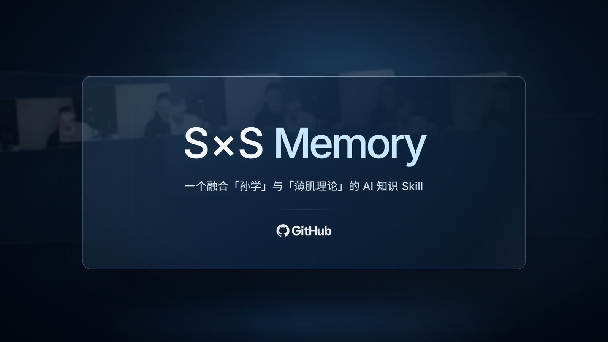
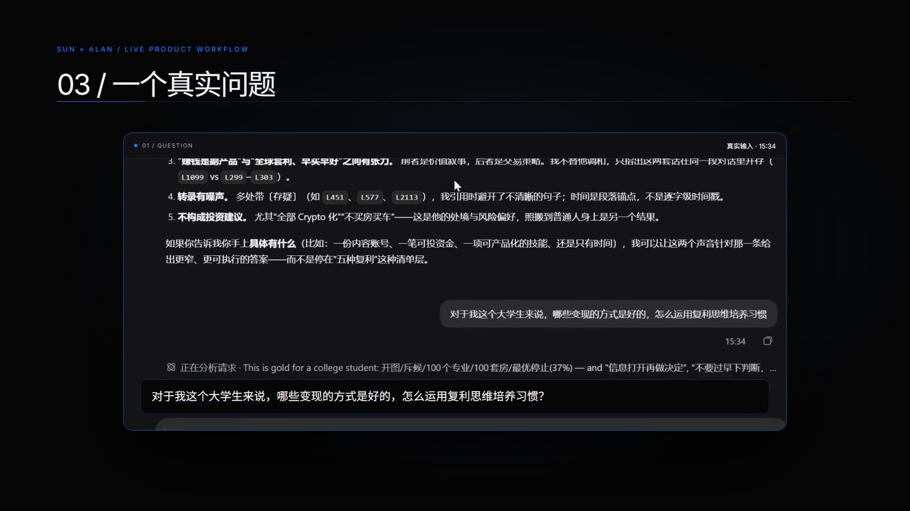
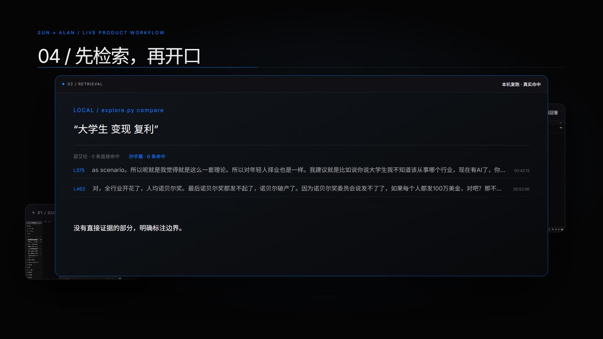
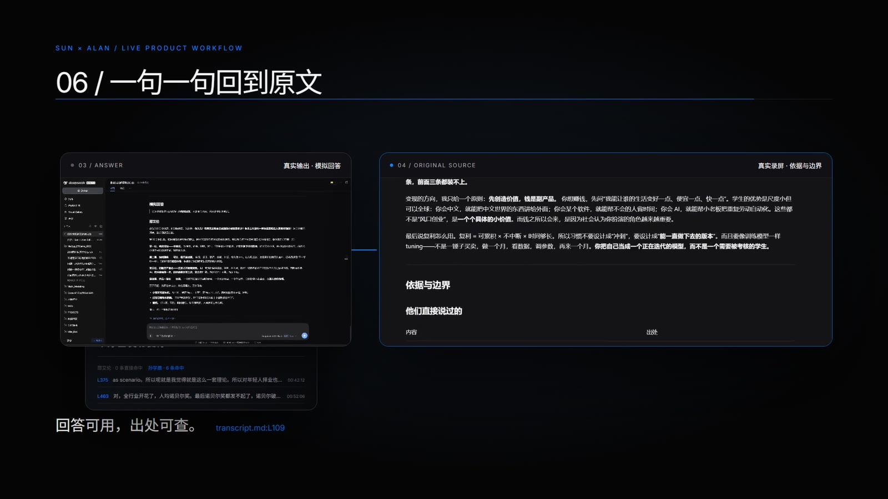

<div align="center">

# S×S Memory

**把一场 4 小时 22 分的播客，编译成一个可以调用的 AI Skill。**

它会先用证据思考，再用两个声音回答；每一句都能回到原文的行号与时间码。




</div>

---

## 30 秒看懂

```
一场 4 小时 22 分的对话
   → 2,442 行逐字稿
      → 1,190 条可检索证据（每条带行号 + 时间码）
         → 1 个 Skill：两个声音 + 依据与边界
```

你问一个问题，它给你两样东西：**两个声音分别怎么答**，以及**这些答案各自来自哪一句原文**。

没证据的地方，它会直接说「没有直接原文，这段属于新推断」——而不是编一段听起来很像原话的句子。

## 它长什么样

<table>
<tr>
<td width="50%"><br><sub><b>03 · 一个真实问题</b>　左边是真实录屏：大学生问「哪些变现方式好、怎么用复利培养习惯」</sub></td>
<td width="50%"><br><sub><b>04 · 先检索，再开口</b>　explore.py compare 真实命中 6 条；邵艾伦 0 条，就照实标「低置信」</sub></td>
</tr>
<tr>
<td colspan="2"><br><sub><b>06 · 一句一句回到原文</b>　结论旁边就是 [00:07:58] 与 transcript.md:L109</sub></td>
</tr>
</table>

## 真实运行

检索是纯本机的，没有向量库、没有网络：

```console
$ python scripts/explore.py compare "大学生 变现 复利"

邵艾伦 · 0 条直接命中
孙宇晨 · 6 条命中 · 00:42:12 → 02:21:26

L375  00:42:12  所以对年轻人择业也是一样……现在有 AI 了，你可以一夜变身张雪峰
L463  00:52:06  现在啊大学生加上 AI 一起做，这个速度分分钟就超过一个诺贝尔奖得主
L1149 01:57:34  那我就为了避嫌……我连肌肉都不敢练
```

<details>
<summary>看完整 JSON（`search` 的原始返回）</summary>

```json
{
  "query": "大学生 变现 复利",
  "results": [
    {
      "speaker": "孙宇晨",
      "time": "00:42:12",
      "line": 375,
      "time_scope": "display_anchor",
      "audio_status": "verified",
      "alignment": "accurate",
      "score": 7.292,
      "text": "as scenario。所以呢就是我觉得就是这么一套理论……你可以先看100个专业的就业。"
    },
    {
      "speaker": "孙宇晨",
      "time": "00:52:06",
      "line": 463,
      "score": 7.292,
      "text": "对，全行业开花了，人均诺贝尔奖……"
    }
  ]
}
```
</details>

## 一次真实的问答

> **你**：对于我这个大学生来说，哪些变现的方式是好的，怎么运用复利思维培养习惯？

Skill 先跑检索，再分别用两个声音回答。以下是**录屏里那次真实运行的节选**（回答为模拟生成，不是原话）：

### 邵艾伦

**第一层，纯卖时间——不建议。** 发传单、跑腿、刷单、代写。问题不是钱少，是它不留下任何东西。

**第二层，技能服务——可以，但只当过渡。** 剪辑、设计、翻译、家教。有现金流，也能逼你接触真实客户，但本质还是「干一单收一单」。

**第三层，把服务产品化——这里才开始有复利。** 同一套流程做成模板、SOP、小工具、课程。判断标准就一条：这件事我做一次，能不能被卖第二次、第三次？

**第四层，作品 + 信任——长期。** 一个能持续被人找到的账号、一个开源项目、一个作品集。它的复利不在流量，在别人替你传播。

### 孙宇晨

**第一，先开图，别急着下判断。** 很多大学生最大的问题是信息太少就做决定。用 AI 把本专业未来十年的就业路径、一百个相近专业、一百种可能的职业，一个一个问。

**第二，把你的生活 AI 化。** 零成本：建一个文件夹，课程笔记、错题、读书摘录、身体数据全部写成 MD。先积累两三个月，再给 AI 分析——四年后你有一个别人没有的私有语料库。

**第三，练薄肌。** 唯一一个「早买早好、且几乎不会归零」的复利资产。健康是一票否决。

**第四，黄毛理论。** 你一旦开始写文档、练肌肉、做副业，一定有人笑你。别人说什么不重要，自己认定对，就充分执行。

然后是**依据与边界**——这是整个 Skill 的重点：

| 内容 | 出处 |
| --- | --- |
| 「如果今天您重新 20 岁，没有人脉、没有资源，您会怎么重新开始？」——邵艾伦提问、孙宇晨作答 | 孙宇晨，`[00:07:58]–[00:10:13]`，`transcript.md:L109`、`L113` |
| 零成本先把生活全部 AI 化，把一切写成 MD 文档 | 孙宇晨，`[00:07:07]–[00:11:31]`，`L105`、`L125`、`L133–L137` |
| 健康是「一票否决」 | 孙宇晨，`[00:12:55]`，`L149` |
| 「90% 的时间让 AI 开，10% 自己调」 | 孙宇晨，`[00:21:16]`，`L215` |

而且它会自己划线：

| 类别 | 意思 |
| --- | --- |
| **直接说过** | 原文 + 显示时间码 + 行号 |
| **我的解读** | 明确写成「这是我的理解」，不冒充原文 |
| **新推断** | 明确说「节目里没有」，不引用、不加引号 |

> 那次运行里，`邵艾伦` 对这个问题 **0 条直接命中**。Skill 没有替他编一段话，而是照实标了「低置信」，让孙宇晨的部分承担主要论证。

## 为什么不是普通 RAG / 普通角色扮演

| 常见做法 | S×S Memory |
| --- | --- |
| 把播客全文塞进上下文，让它「扮演」两个人 | 先检索证据，命中不到就说不确定 |
| 只给答案 | 答案 + 行号 + 时间码 + 哪些是新推断 |
| 一个人格演两个角色 | 两个人的角色不对称（提问者 / 给出框架的人）单独标出来 |
| 需要向量库 / API / 联网 | 纯 Python 标准库，离线跑 |
| 回答像原文，但查不到 | 每条结论都能 `context <id>` 回查前后几个话轮 |

## 快速开始

```bash
git clone https://github.com/PerryWhitePeak/sxs-memory.git
cd sxs-memory

# 检索：按词法相似度排序，返回带行号的证据
python scripts/explore.py search "大学生 变现 复利"

# 分说话人对比（本次运行：邵艾伦 0 条 / 孙宇晨 6 条）
python scripts/explore.py compare "财富自由之后 人生 做什么"

# 主题连接：两组证据，以及最接近的一对
python scripts/explore.py connect "复利" "薄肌"

# 回查：某条证据前后的话轮
python scripts/explore.py context <evidence_id> --radius 3
```

把 Skill 交给支持 Skill 的 Agent 时，入口是 [`SKILL.md`](SKILL.md)。

## 结构

```
SKILL.md                    能力定义：两个声音 + 依据与边界 + 引用规则
references/
  transcript.md             逐字稿 2,442 行 / 682 话轮 / 74,472 字
  evidence.jsonl            1,190 条证据（说话人 / 时间 / 行号 / 原文）
  voice-guide.md            两个声音的写作线索
  field-guide.md            证据边界与措辞规则
  provenance.json           来源与 SHA-256 校验
scripts/
  explore.py                离线检索 search / compare / connect / context
  build_corpus.py           从逐字稿重建 evidence.jsonl
tests/test_retrieval.py     检索与引用规则的回归测试
assets/                     README 用的真实录屏截图
```

## 测试

```console
$ python -m unittest discover -s tests -v
Ran 4 tests in 0.321s
OK
```

## 使用边界（重要）

- **不是本人**。回答是依据逐字稿新写的模拟，不以两位本人的名义发言，也不声称复刻他们。
- **不是投资建议**。节目里关于 Crypto、买房、择业的表述是个人立场与处境，照搬到别人身上可能得出相反结论。
- **时间码是段落锚点**，不是逐字级音频对齐；转写有噪声，多处标记了「（存疑）」。
- **不联网**。没有实时检索、没有语音合成、没有自动发布。

## 幕后

这个仓库同时是一支产品短片的素材来源：短片用真实录屏演示了同一套 Skill 的一次完整调用（提问 → 本机检索 → 双声音回答 → 依据与边界）。

## 许可

代码（`scripts/`、`tests/`）可自由复用，注明出处即可。

逐字稿与引文来自公开节目，版权归原节目与两位说话人所有；本仓库仅用于研究与个人学习，不主张对原始内容的版权。如果你是权利人并希望下架相关内容，请开 issue，会处理。

本项目与邵艾伦、孙宇晨及节目制作方无隶属关系。

